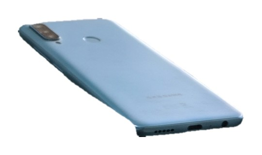
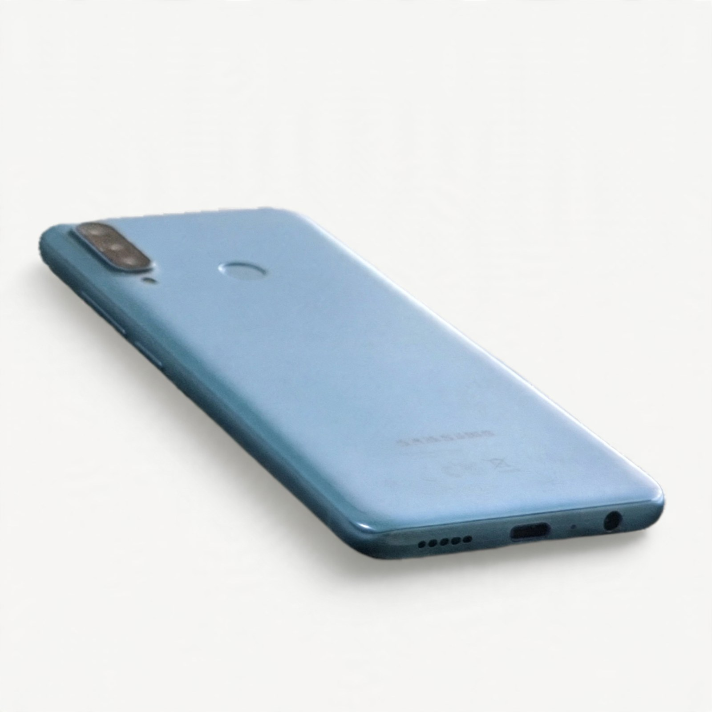
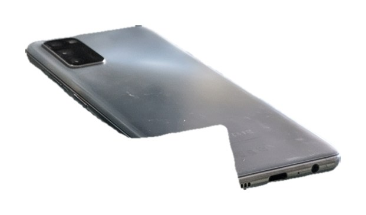
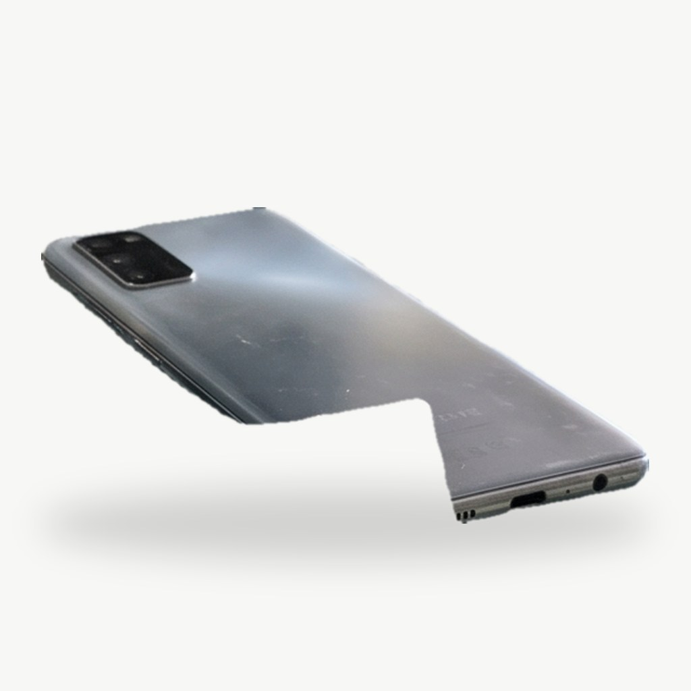
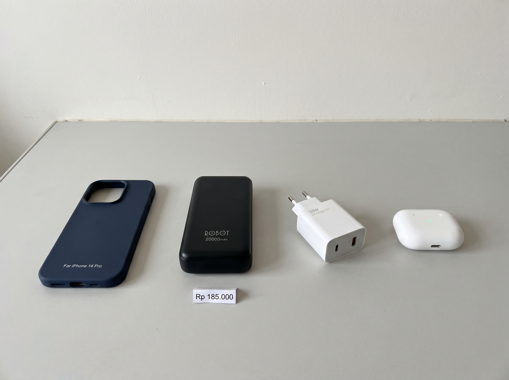
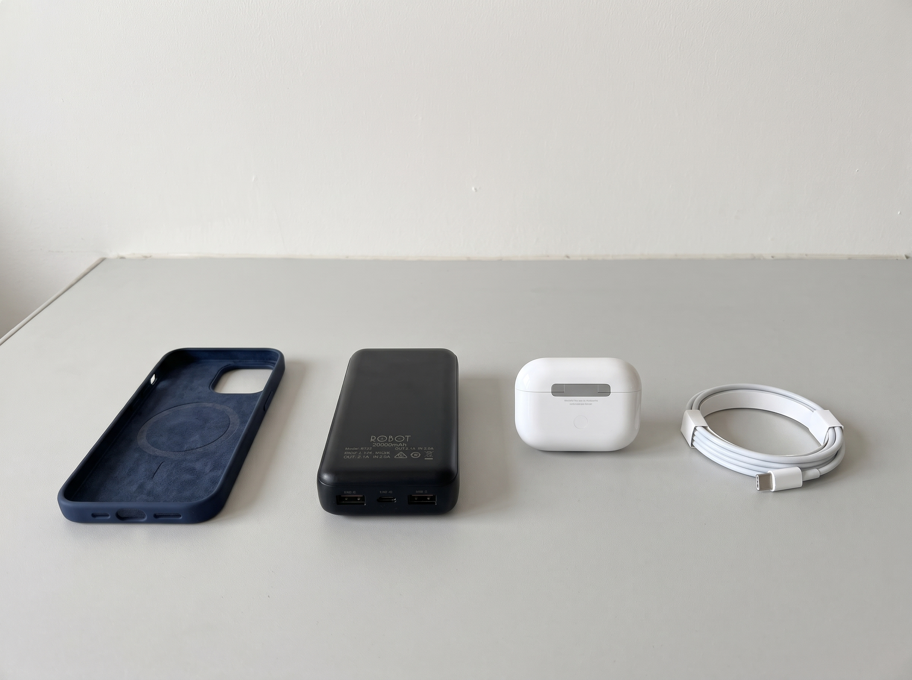
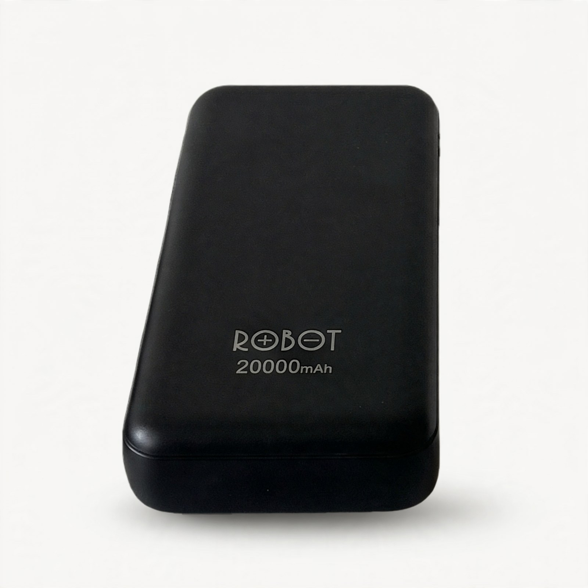
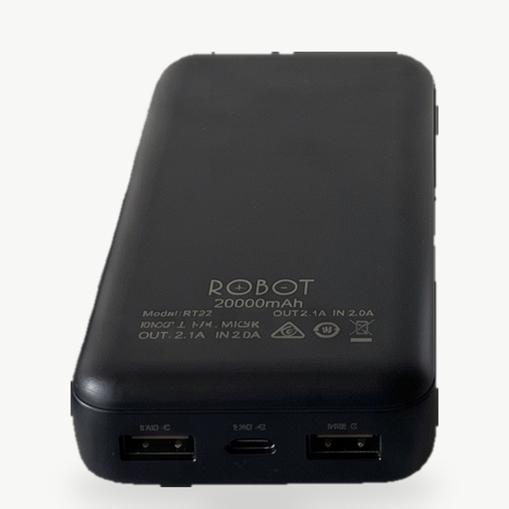
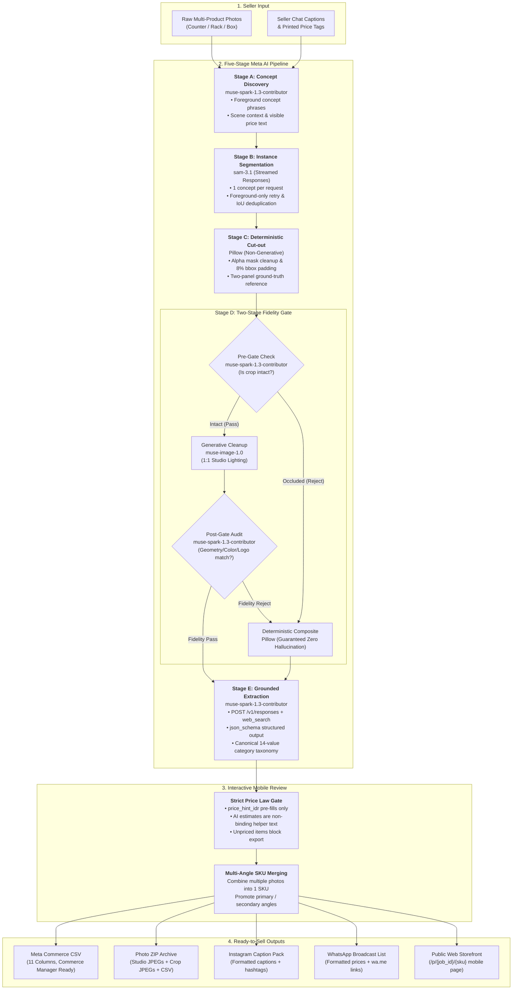

# ⚡ Katalog Kilat

*From messy chat photos to a ready-to-sell Meta catalog in one click.*

| Hackathon Track | Problem Statement | Meta AI Models Used | Core Output |
| :--- | :--- | :--- | :--- |
| **Indie Developer** | **Build for Your World** (Social Commerce) | `muse-spark-1.3-contributor` · `sam-3.1` · `muse-image-1.0` | Meta Commerce Manager 11-Column CSV, Studio Photo ZIP, IG Captions, WhatsApp Price List, Public Gallery |

---

## 🚀 Try It Now

> [!IMPORTANT]
> **Live Web Application**: **[https://metahackathon.my.id](https://metahackathon.my.id)**  
> **API Health Probe**: `https://metahackathon.my.id/api/health` → `{"ok":true,"mock":false}`  
> **Viewing Mode**: Mobile device or browser window resized to phone width (360–430 px) is recommended for the full-screen native mobile experience. On wider desktop viewports (≥768 px), the application is automatically presented inside a centered iPhone device frame.  
> **Hosting Duration**: The live deployment is hosted on an isolated cloud server through **2026-11-14**.

---

## 📱 Judge Walkthrough (about 10 minutes including the processing wait)

Follow this step-by-step walkthrough to evaluate the complete end-to-end user experience on the live deployment:

1. **Upload Screen (`/`)**:
   - Open [https://metahackathon.my.id](https://metahackathon.my.id). By default, the interface is in Indonesian (`id`), the primary language of Indonesian social commerce sellers.
   - *(Optional: Settings Sheet)* Tap the gear icon in the top bar to open the settings sheet. You can toggle between Indonesian (`id`) and English (`en`), or switch the appearance between System (default), Light, and Dark mode. Switching is instant and persists across sessions.
   - Tap sample pack **"Paket A"** (two smartphone counter photos with printed price cards). The photo thumbnails appear.
   - Tap the dominant bottom action button **"Proses Katalog"** ("Process Catalog") to submit the job to the live pipeline.

2. **Progress Screen (`/jobs/{job_id}`)**:
   - The screen displays a live 5-stage progress timeline:
     - **A — Spotting products** (*"Mengenali produk"*): `muse-spark-1.3-contributor` discovers product concepts (`smartphone`, `earphones`, `charger`) and transcribes visible text.
     - **B — Cutting each product out** (*"Memotong tiap produk"*): `sam-3.1` streams instance segmentation masks (one concept per request), followed by deterministic Pillow alpha cut-outs.
     - **C — Tidying photos** (*"Merapikan foto"*): Two-stage fidelity gate audits crops before and after `muse-image-1.0` studio edits, falling back to deterministic composites on rejection.
     - **D — Writing the catalog** (*"Menulis katalog"*): `muse-spark-1.3-contributor` runs search-grounded (`web_search`) structured extraction over Meta's Responses API into canonical categories.
     - **E — Catalog result** (*"Hasil katalog"*): Aggregates tidied products into ready-to-review catalog cards.
   - For Pack A (2 photos, 16 products), live processing takes about 5–6.5 minutes depending on the pack and API load.
   - Once completed, the screen indicates "Katalog siap" (Catalog ready) with 16 products and 0 errors. Tap **"Tinjau 16 produk"** ("Review 16 products").

3. **Review Screen (`/review`) & The Strict Price Law Test**:
   - The review screen displays cards for all extracted products, showing studio photos, fidelity badges (`Lolos cek` for passed `muse-image-1.0` edits or `Foto standar` for composite fallbacks), bilingual descriptions, and canonical categories.
   - **Test the Strict Price Law**:
     - `price_hint_idr` pre-fills only when the amount is printed in that product's own photo (visible text) or written in the caption attached to that product's own photo; a price that appears only in the general caption never pre-fills. For Pack A, four products carrying the printed `Rp 1.500.000` tag in the photo (KK-0004, KK-0005, KK-0006, KK-0011) are pre-filled with that price. Five products whose cut-out was incomplete (acrylic display stand fused into the phone's silhouette, bite out of the body, or partial mask) are switched OFF by default by the composite guard and shown as excluded (`Tidak dimasukkan`); the seller can inspect them and toggle them back on at any time.
     - Products with an AI market suggestion or general-caption price display grey helper text **"Saran AI: Rp... — periksa lagi"** while their price input field remains **strictly empty**.
     - Scroll to the sticky bottom bar: a summary counter reports progress reflecting active items (for Pack A at initial review: *"3 produk siap · 8 belum ada harga"* / *"3 products ready · 8 missing a price"*, because three of the four pre-filled phones are among the 11 active items). When any included item lacks a price, a warning button lists the unpriced items (*"KK-0003 · HP Smartphone Second Gold Kondisi Normal Siap… dan 7 lainnya belum ada harga"*) and opens a bottom sheet listing every unpriced SKU.
     - The primary action button **"Lanjut"** ("Continue") is **strictly blocked** (`aria-disabled="true"`). Tapping it automatically moves focus to the price input of the first unpriced product.
     - Type a price for each product (e.g., `150000`) or toggle **"Harga via chat"** ("Price via chat") for items sold upon customer inquiry. Once all products have a confirmed price or via-chat status, the blocked button immediately unlocks.
   - *(Multi-Angle Merging)*: Notice the **"Gabung foto ke produk lain"** ("Merge photo into another product") button on product cards. Tapping it opens an inline picker sheet to select a target product. When secondary photos of the same item are merged into a single SKU, the card gains controls to promote a secondary angle to primary ("Utama") or unmerge ("Pisahkan").
   - Tap **"Lanjut"** to open the Store Preview (`/review/preview`), then tap **"Lanjut ke ekspor"** to proceed.

4. **Export Screen (`/export`) & File Verification**:
   - Enter a store name (e.g. `Toko Demo`) and a WhatsApp phone number with international digits only (e.g. `6281234567890`).
   - Tap **"Ekspor katalog"** ("Export catalog"). In about 2–3 seconds, all four export files and public share links are compiled (for Pack A: 16 found, 11 exported by default; the 5 switched-off items remain excluded unless toggled on by the seller).
   - **What to verify in each export deliverable**:
     - **`katalog-meta.csv` (Meta Commerce Catalog Feed)**: Open the downloaded CSV. It contains exactly 11 canonical columns (`id,title,description,availability,condition,price,link,image_link,brand,product_type,additional_image_link`), with 11 rows for Pack A's included items. All prices are formatted strictly as `{integer} IDR` (e.g. `150000 IDR`). Products marked "Harga via chat" are **excluded from the CSV** (no `0 IDR` placeholders). No AI-suggested price appears anywhere.
     - **`katalog-kilat-images.zip` (Photo Archive)**: Contains clean studio JPEGs (`KK-0003.jpg`), clean crops (`KK-0003-crop.jpg`), and secondary angles (23 items total: 11 studio shots + 11 crops + 1 CSV for Pack A), with `katalog-{job_id}.csv` bundled at the root.
     - **`katalog-…-captions.txt` (Instagram Captions)**: Ready-to-copy caption blocks containing product title, confirmed price (or `"harga via chat"`), description prose, WhatsApp ordering line with seller phone number, and slugified category/brand hashtags separated by dividers.
     - **`katalog-…-whatsapp.txt` (WhatsApp Broadcast List)**: Chat-ready broadcast text with Markdown formatting, confirmed prices, and direct inquiry links.
     - **Public Product Page (`/p/{job_id}/{sku}`)**: Under **"Tautan produk"** ("Product links", tap to expand), click one of the share links. It opens a clean, standalone mobile product storefront rendering the studio hero photo (with a scroll-snap carousel track and count badge for merged angles), store chip, product name, confirmed price (or `"harga via chat"`), description prose, category/condition chips, OpenGraph link-preview tags, system-matched light/dark styling, and a pinned bottom bar with a one-tap **"Pesan via WhatsApp"** order button pointing to `wa.me/{phone}`.
   - *Additional Sample Packs & Custom Photos*:
     - You can also upload your own multi-product photos (JPG, PNG, WebP) on the Upload screen. Processing time scales with the number of products.
     - Sample packs are available on the Upload screen: **Paket B** (clothing rack), **Paket C** (cardboard snack box / "Kardus snack"), and **Paket D** (two opposite-side photos of gadget accessories designed specifically to showcase multi-angle merging).

---

## 🛠️ Run It Yourself

Follow these instructions to run the entire stack locally using Docker Compose or bare-metal development.

### Prerequisites

- **Docker & Docker Compose v2**: Docker Engine 24+ with Compose v2.
- **Meta Model API Key**: An active API key with access to:
  - `muse-spark-1.3-contributor` (concept discovery, fidelity audit, grounded catalog extraction)
  - `sam-3.1` (streaming instance segmentation)
  - `muse-image-1.0` (generative studio lighting & cleanup)
- No other dependencies: the container multi-stage build compiles the React SPA with Node 26 and serves it alongside the Python 3.12 FastAPI backend. First build takes a few minutes.

### Step-by-Step Setup with Docker Compose

1. **Clone the repository**:
   ```bash
   git clone https://github.com/daniadasaya/metahackathon.git
   cd metahackathon
   ```

2. **Configure environment variables**:
   ```bash
   cp .env.example .env
   ```
   Open `.env` and set:
   - `MODEL_API_KEY`: Your Meta Model API key (server-side only; never sent to the client).
   - `BASE_URL`: Public origin used to build absolute `image_link` and `link` URLs in the exported Meta Commerce CSV. Use `http://localhost:8180` for local runs.
   - `META_MOCK`: Set to `false` for live inference against `api.meta.ai`.
   
   > [!NOTE]
   > `docker-compose.yml` defaults `META_MOCK` to `true` when unset so a bare clone boots without a key, while `.env.example` explicitly sets `META_MOCK=false`. When `META_MOCK=false`, the container executes live against the Meta Model API. When `mock: true`, the pipeline runs offline against recorded test fixtures (useful for offline plumbing tests, but not a live demo).

3. **Build and start the container**:
   ```bash
   docker compose -p katalogkilat up -d --build api
   ```
   *Note*: Specifying `api` starts only the web & API container and omits the optional Cloudflare `tunnel` service, which requires a Cloudflare token not needed for local evaluation.

4. **Verify service health**:
   ```bash
   curl -s http://localhost:8180/api/health
   # Expected output for live mode:
   # {"ok":true,"mock":false}
   ```

5. **Open in browser**:
   Navigate to [http://localhost:8180](http://localhost:8180). Processed jobs and catalog exports persist in `./data` on your host.

6. **Stop and clean**:
   ```bash
   docker compose -p katalogkilat down
   ```

---

### Local Development Without Docker

If you prefer to run services directly on your host machine:

- **Requirements**: Python 3.12 (container) — 3.12 or newer for local dev (tested through 3.14), Node.js 20+

1. **Terminal 1 — FastAPI Backend (port 8100)**:
   ```bash
   cd apps/api
   python3 -m venv .venv
   source .venv/bin/activate
   pip install -r requirements-dev.txt
   export MODEL_API_KEY="your_meta_api_key"
   export BASE_URL="http://localhost:4100"
   export META_MOCK="false"
   uvicorn app.main:app --host 127.0.0.1 --port 8100 --reload
   ```

2. **Terminal 2 — Vite Web App (port 4100)**:
   ```bash
   cd apps/web
   npm install
   npm run dev
   ```
   Open [http://localhost:4100](http://localhost:4100) (Vite proxies `/api` and `/p` requests directly to `http://127.0.0.1:8100`).

3. **Running the Test Suite**:
   ```bash
   # Run backend offline test suite inside container (the full offline suite passes):
   docker compose -p katalogkilat exec -e META_MOCK=true api pytest apps/api/tests -q

   # Verify frontend TypeScript build (install dependencies first if not already done):
   npm --prefix apps/web install
   npm --prefix apps/web run build
   ```
   The backend test suite uses recorded fixtures and needs no key or network; it is not a live check.

---

## Known Limitations

- **Processing time scales with product count**: Processing duration grows directly with the number of detected products and model calls. Pack A (2 photos, 16 products) takes about 5–6.5 minutes on the live pipeline, while a heavier run of six large photos took about 12–13 minutes.
- **Upload constraints and normalization**: At most 30 photos are accepted per job, capped at 10 MB per file. Uploaded images are resized to a maximum of 2,400 px on the long side (using Lanczos downsampling) and re-encoded as JPEG (quality 90). Any undecodable file causes the entire upload to be rejected with the specific filename identified.
- **Incomplete cut-out guard**: When the fidelity pre-gate or post-gate falls back to a deterministic composite, any cut-out with alpha coverage below the 80% threshold (`COMPOSITE_MIN_COVERAGE = 0.80`) is automatically switched OFF by default in the Review screen, leaving the seller to inspect the crop and toggle it on manually if acceptable. In the Pack A run, five of sixteen products were switched off due to incomplete cut-outs (acrylic display stand fused into the silhouette or bites out of the body), and one of those five carried a printed tag price.
- **Echoed product names**: Extracted product names can echo a product line from the caption or a neighbouring product (observed in testing: ten unbranded cosmetic bottles labeled "MOCK-UP" in the photo were named "Skincare Endless Pure …" when that phrase appeared in the general caption). Sellers should review product names before export.
- **Model extraction accuracy**: Extracted product names and brands can occasionally be swapped or misattributed when multiple visually similar items appear in the same photo (observed in testing when two similar Glossier cosmetic products swapped names). Product condition (`new` or `used`) is an AI estimate from visual cues and should be reviewed before export.
- **Commerce Manager feed validation**: The generated 11-column catalog feed CSV has been validated against the documented Meta Commerce Manager feed specification by automated tests, but has not been imported into a live Meta Commerce Manager account in this project.
- **Temporary single-key deployment**: The public demo deployment is hosted under a temporary VPS lease valid until 2026-11-14 and operates on a single shared Meta API key; concurrent multi-photo submissions will contend for API concurrency and experience extended queue times.
- **Offline test suite**: The backend test suite runs against frozen, recorded fixtures for deterministic offline execution without network access; it does not constitute a live availability check against Meta Model API endpoints.
- **Serialized segmentation parsing**: Response parsing for `sam-3.1` streamed instance segmentation is serialized in Python across concepts, meaning large multi-product photos spend the majority of their overall processing time in the segmentation stage.

---

## 🔧 Troubleshooting

| Issue | Cause | Solution |
| :--- | :--- | :--- |
| `401 invalid_api_key` | Invalid or expired Meta Model API key | The pipeline fails at Stage A (`concepts_failed`). Check `MODEL_API_KEY` in `.env` for typos, extra quotes, or leading/trailing whitespace. Test the key directly: `curl -H "Authorization: Bearer $MODEL_API_KEY" https://api.meta.ai/v1/models`. |
| `404 model_not_found` | Account lacks model entitlement | Your Meta account lacks entitlement to `muse-spark-1.3-contributor`, `sam-3.1`, or `muse-image-1.0`. The service surfaces this access problem immediately and does not retry. |
| CSV image links broken / dead | Mismatched `BASE_URL` | The exported CSV builds absolute image URLs from `BASE_URL`. For local testing, ensure `BASE_URL=http://localhost:8180` in `.env`. Re-export the catalog after correcting. |
| Port 8180 or container name conflict | Another process binds port 8180, or a container named `katalogkilat-api` already exists | Change the host port in `docker-compose.yml` (e.g. `"127.0.0.1:8182:8000"`) AND update `BASE_URL` in `.env` to match (`http://localhost:8182`). If a container named `katalogkilat-api` already exists from an earlier run, remove it with `docker rm -f katalogkilat-api` or remove the pinned `container_name: katalogkilat-api` line in `docker-compose.yml`. |
| Long processing time (~5–6.5 min) | High model count and sequential audits | Live processing involves streaming segmentation, two-stage fidelity audits, and grounded extraction per item (about 5–6.5 minutes live depending on the pack and API load). This is normal. |
| Images fail to load on `/p/` | Data volume permission or missing job | Check that `./data` exists and is writable. Healthy jobs serve verified JPEG artifacts (`image/jpeg`); missing artifacts return a deterministic 1024×1024 JPEG placeholder. |
| `mock: true` in `/api/health` | `META_MOCK` is not `false` | When `META_MOCK` is unset or not `false`, the server runs in mock mode using fixtures. Ensure `META_MOCK=false` in `.env` and restart the container. |

---

## The Problem vs. Katalog Kilat

Social-commerce sellers across Indonesia run high-volume retail businesses entirely inside WhatsApp, Instagram, and Facebook chats. Their products are photographed in raw, cluttered batches on shop counters, display racks, and cardboard boxes, while their pricing lives in casual chat messages — making traditional catalog creation impossibly tedious.

| Dimension | Traditional Catalog Workflow | ⚡ Katalog Kilat |
| :--- | :--- | :--- |
| **Photo Input** | Clean, 1-product-per-photo studio shots required | Raw, messy multi-product counter/rack/box photos |
| **Product Isolation** | Manual cropping & background removal per item | Automated concept discovery (`muse-spark-1.3-contributor`) + streamed instance segmentation (`sam-3.1`) |
| **Studio Cleanup** | Unchecked generative AI that can hallucinate details | `muse-image-1.0` guarded by a **Two-Stage Fidelity Gate** + deterministic Pillow fallback |
| **Catalog Copy & Specs** | Manual typing per SKU | `POST /v1/responses` + **Web Search Grounding** + `json_schema` bilingual extraction |
| **Pricing Trust** | AI guesses or manual spreadsheet entry | **Strict Price Law**: only amounts printed in a product's photo or written in that photo's own caption pre-fill; general captions and AI estimates are helper text only |
| **Multi-Angle Items** | Duplicate rows or manual URL pasting | Interactive **Multi-Angle SKU Merge** in mobile review → `additional_image_link` |

---

## Visual Showcase: From Messy Counter Photo to Studio Catalog

### 1. Multi-Product Detection, Studio Cleanup & Two-Stage Fidelity Gate

Katalog Kilat detects individual items from cluttered counter photos, runs generative studio cleanup, and applies strict fidelity verification. If an item is occluded or generative cleanup alters product branding, the pipeline automatically falls back to an authentic deterministic composite.

| Raw Multi-Product Seller Photo | Pipeline Step | Output Image | Fidelity Inspection & Result |
| :---: | :---: | :---: | :--- |
|  | **Stage C: Cut-out**<br>*(KK-0004)* |  | **Input to Fidelity Gate**: Segmented smartphone instance with clean edges and transparent background. |
| *(Raw counter photo: 6 smartphones, cables, earbuds, and Rp 1.500.000 price card)* | **Stage D: Studio Shot**<br>*(Fidelity PASS)* |  | **Fidelity Gate PASS (`muse-image-1.0`)**: 1:1 off-white studio lighting. Inspector audits confirm `same_product: true`, `color_match: true`, `logo_text_match: true`. |
|  | **Stage C: Cut-out**<br>*(KK-0006)* |  | **Input to Fidelity Gate**: Smartphone cut-out notched on the bottom-left corner by the price sign. |
| *(Occluded item detected)* | **Stage D: Fallback**<br>*(Fidelity REJECT)* |  | **Fidelity Pre-Gate REJECT → Pillow Composite**: Pre-gate catches the missing corner before calling generative edit. Deterministic composite prevents AI hallucination. |

### 2. Multi-Angle SKU Merging (Opposite-Side Photos → Single SKU)

When sellers photograph products from multiple angles, Katalog Kilat allows merging secondary photos into a primary SKU directly in the mobile review screen, automatically populating the Meta Commerce `additional_image_link` feed column.

| Photo 1 — Front Angles | Photo 2 — Rear/Port Angles | Merged SKU: Primary Angle (`image_link`) | Merged SKU: Secondary Angle (`additional_image_link`) |
| :---: | :---: | :---: | :---: |
|  |  |  |  |
| *Counter photo: Front view of case, power bank, and earbud pack* | *Opposite view: Rear ports, back specs, and barcode details* | **Primary Studio Photo**: Clean front view exported as main catalog image `image_link`. | **Secondary Studio Photo**: Clean rear view exported into `additional_image_link`. |

---

## Multi-Model Architecture & Pipeline

Katalog Kilat coordinates three Meta models across a five-stage pipeline where each model checks the others' work:



### 5-Stage Pipeline Matrix

| Stage | Owner Model / Engine | API Surface | Input → Output | Engineering Guardrail |
| :--- | :--- | :--- | :--- | :--- |
| **Stage A: Concept Discovery** | `muse-spark-1.3-contributor` | Vision Chat Completion | Raw multi-product photo + seller captions → Noun concept phrases, scene notes, visible text | Foreground-only focus; ignores display stands, mannequins, hands, and background clutter |
| **Stage B: Instance Segmentation** | `sam-3.1` | Streamed Responses (`meta-sam-parser`) | Single concept phrase + photo → Binary instance segmentation masks | 1 concept per request; automatic `foreground {concept}` retry on zero-mask results; IoU & containment deduplication |
| **Stage C: Deterministic Cut-out** | Pillow (Non-generative) | Local Python image processing | Binary mask + raw photo → Alpha cut-out with 8% bounding-box padding | Largest Connected Component (LCC) filtering; pinhole hole-filling; 2-panel ground-truth visual reference generation |
| **Stage D: Studio Cleanup & Fidelity Gate** | `muse-image-1.0` + `muse-spark-1.3-contributor` | Image Editing (`POST /v1/images/generations/edits`) + Vision Audit | Alpha cut-out + 2-panel reference → 1:1 studio JPEG or deterministic Pillow composite | **Two-Stage Fidelity Gate**: Pre-Gate rejects occluded crops; Post-Gate verifies `same_product`, `color_match`, `logo_text_match`; automatic fallback to deterministic composite |
| **Stage E: Grounded Extraction** | `muse-spark-1.3-contributor` | Responses API (`POST /v1/responses`) | Clean image + visible text + captions → Structured `ProductEntry` JSON | Search Grounding (`web_search`) in Indonesian region; `json_schema` output; 14 canonical Indonesian categories; zero price invention |

---

## Core Engineering Guarantees

> [!IMPORTANT]
> **Strict Price Law (Zero Invented Prices)**
> AI models frequently hallucinate prices when examining retail items. In social commerce, an incorrect price destroys customer trust. Katalog Kilat enforces an absolute architectural boundary: **AI estimates never pre-fill price fields and never reach any export**.
> Only numbers printed in that product's own photo (visible text) or written in the caption attached to that product's own photo (`price_hint_idr`) can pre-fill review inputs. A price that appears only in the general caption never pre-fills — it becomes grey helper text (`Saran AI: Rp… — periksa lagi`), leaving the field empty. Unpriced items strictly block catalog export until confirmed by the seller.

### Price Law Truth Table

| Field | Origin | Review UI Behavior | Export Behavior (CSV / ZIP / IG / WA) |
| :--- | :--- | :--- | :--- |
| `price_hint_idr` | Amount printed in that product's photo (visible text) or caption attached to that product's photo (never general caption) | Pre-fills the price input (`--price-verified`) | Exported once confirmed as `price_idr` |
| `price_suggestion_idr` | AI market estimate (vision / `web_search`) or general-caption price | Grey helper text (`Saran AI: Rp… — periksa lagi`) | **Never** pre-fills; **physically absent** from export request schema |
| `price_idr` | Seller-confirmed integer IDR | Editable mono input (`Rp150.000`) | Formatted as `{price_idr} IDR` in CSV and `Rp150.000` in IG/WA |
| `price_via_chat = true` | Seller toggle on Review card | Collapses price input to `"Harga via chat"` | Excluded from CSV (`0 IDR` is forbidden); rendered as `"harga via chat"` in IG/WA; photo kept in ZIP |
| `price_idr = null` & `price_via_chat = false` | Unpriced item | Warning border + SKU named in sticky bar | **Blocks export** on both client CTA and `POST /api/jobs/{id}/export` (`400 price_missing`) |

> [!TIP]
> **Two-Stage Fidelity Gate & Multi-Angle SKU Merging**
> - **Zero Ungated Generative Images**: Generative image editing (`muse-image-1.0`) is powerful but prone to hallucinating textures or redesigning products. The Pre-Gate evaluates raw cut-outs before spending edits, while the Post-Gate verifies product geometry, color fidelity, and branding. Any rejected edit automatically falls back to an authentic non-generative Pillow composite.
> - **Multi-Angle Support**: When sellers capture front and back photos of an item, the review interface allows merging secondary angle cut-outs directly into a single product listing, automatically populating the Meta Commerce `additional_image_link` feed column.

---

## Catalog Outputs & API Surface

### Downloadable Outputs & Public Storefront

| Output Artifact | Format | Consumers | Key Specification |
| :--- | :--- | :--- | :--- |
| **Meta Commerce Catalog Feed** | `.csv` | Meta Commerce Manager, Facebook Shop, Instagram Shop, WhatsApp Catalog | 11 canonical columns (`id,title,description,availability,condition,price,link,image_link,brand,product_type,additional_image_link`), UTF-8, CRLF, strict Price Law formatting (`{price} IDR`) |
| **Product Photo Archive** | `.zip` | E-commerce marketplaces, archival storage, bulk marketing uploads | 1:1 studio JPEGs, clean cut-out JPEGs, secondary angle photos, with `katalog-{job_id}.csv` bundled at root |
| **Instagram Caption Pack** | `.txt` | Instagram feed posts, carousels, Stories, and Reels | Ready-to-post caption blocks with Indonesian pricing, description prose, WhatsApp ordering contact, and slugified hashtags |
| **WhatsApp Price List** | `.txt` | WhatsApp Business broadcasts, community groups, direct chats | Chat-ready broadcast format with Markdown typography (`*bold*`, `_italic_`), `"harga via chat"` handling, and `wa.me` links |
| **Public Product Gallery** | `/p/{job_id}/{sku}` | Mobile buyers via shared links | Responsive standalone storefront rendering multi-angle photo carousel, store chip, description prose, category/condition chips, and one-tap WhatsApp order button |

### REST API Endpoints

The FastAPI backend exposes 9 REST routes with contracts defined in `apps/api/openapi.json`:

| Method | Endpoint | Purpose |
| :--- | :--- | :--- |
| `GET` | `/api/health` | Service liveness probe reporting server status and mode (`mock: true/false`) |
| `POST` | `/api/jobs` | Create multi-photo extraction job from uploaded photos and captions |
| `GET` | `/api/jobs/{job_id}` | Poll job status, pipeline progress, and extracted product records |
| `POST` | `/api/jobs/{job_id}/products/{sku}/retry-cleanup` | Retry generative studio cleanup for a specific SKU |
| `POST` | `/api/jobs/{job_id}/products/{sku}/toggle-cleanup` | Toggle between studio cleaned image and deterministic composite |
| `POST` | `/api/jobs/{job_id}/export` | Validate Price Law and fidelity gate, then compile all export artifacts |
| `GET` | `/api/exports/{job_id}/{filename}` | Download generated catalog export files (CSV, ZIP, TXT) |
| `GET` | `/p/{job_id}/{sku}.jpg` | Serve high-resolution JPEG product image |
| `GET` | `/p/{job_id}/{sku}` | Public mobile product details page with direct WhatsApp ordering link |

---

## Tech Stack

| Layer | Technology | Description |
| :--- | :--- | :--- |
| **Frontend** | React 19, TypeScript, Vite, TanStack Router & Query, Tailwind CSS | Phone-first Single Page Application with native mobile app anatomy (compact top bar with back navigation and 5-step progress indicator, bottom settings sheet for language and appearance, single pinned primary action, 44px touch targets), bilingual interface (`id` default, `en`), and 3 theme states (`system`, `light`, `dark`). Desktop view renders inside a centered iPhone device frame. |
| **Backend** | Python 3.12, FastAPI, Pydantic v2, Uvicorn | High-performance asynchronous REST backend with strict schema validation and OpenAPI contract generation. |
| **Imaging** | Pillow, `meta-sam-parser` | Non-generative image processing, mask raster decoding, connected-component filtering, alpha extraction, and deterministic compositing. |
| **AI Models** | `muse-spark-1.3-contributor`, `sam-3.1`, `muse-image-1.0` | Meta Model API orchestration for vision concept discovery, instance segmentation, generative cleanup, fidelity inspection, and search-grounded catalog extraction. |
| **Packaging** | Docker, Docker Compose | Unified multi-stage container hosting both compiled frontend static assets and FastAPI backend service. |

---

## Repository Structure

```text
metahackathon/
├── apps/
│   ├── api/                      # FastAPI backend service, pipeline, schemas, and tests
│   └── web/                      # Vite + React SPA, components, routes, locales, and design system
├── docs/                         # Model prompts and specifications
├── scripts/                      # Optional server deployment teardown scripts
├── .dockerignore                 # Container build exclusions
├── .env.example                  # Environment configuration template
├── .gitignore                    # Git tracking exclusions
├── docker-compose.yml            # Unified container service definition
├── LICENSE                       # Proprietary license and Hackathon Evaluation Grant
└── README.md                     # Project documentation and run instructions
```

---

## Documentation

| Document | Description |
| :--- | :--- |
| [`docs/prompts-final.md`](docs/prompts-final.md) | Final prompt versions and execution specifications for Meta Model API calls. |
| [`apps/api/openapi.json`](apps/api/openapi.json) | Committed OpenAPI contract specifying all 9 routes and 28 schema components. |
| [`apps/web/design/brandkit.md`](apps/web/design/brandkit.md) | Interface notes, design tokens, responsive behavior, and native mobile layout guidelines. |
| [`LICENSE`](LICENSE) | Proprietary License & Hackathon Evaluation Grant terms. |

---

## License

Proprietary License with Hackathon Evaluation Grant for the Meta Global AI Developer Hackathon 2026 — see [`LICENSE`](LICENSE).
