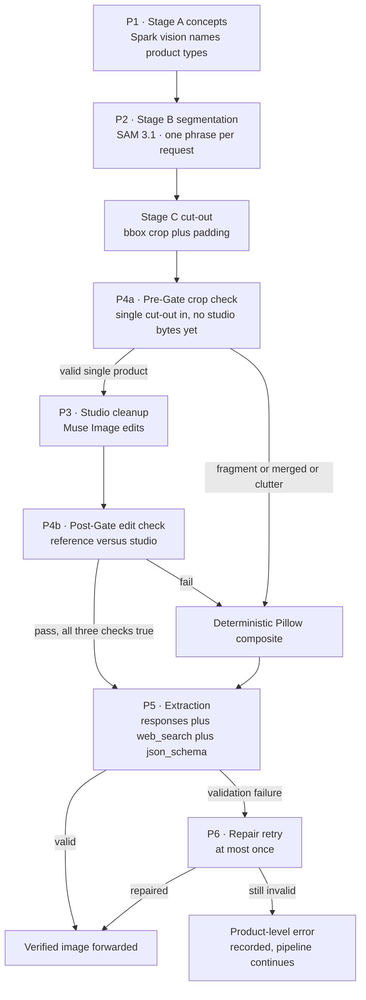
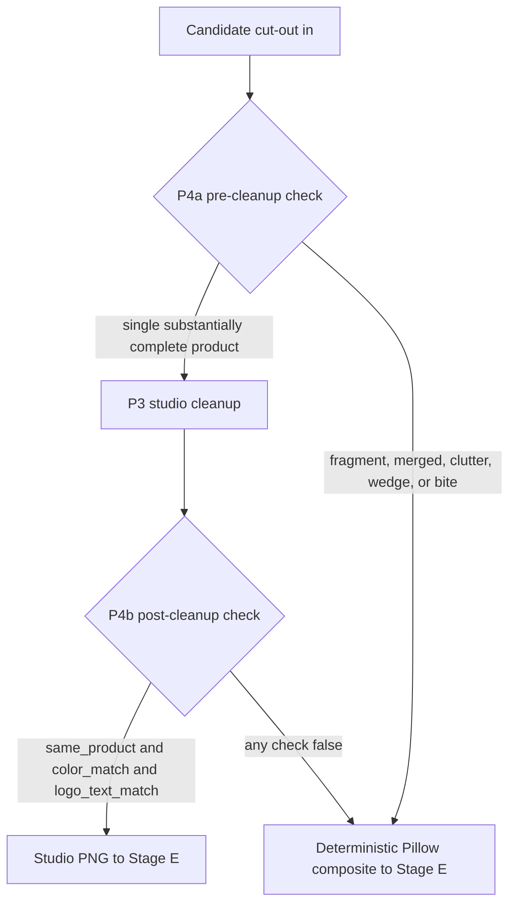

# Katalog Kilat — Meta Model API Prompt & Verification Specification

Katalog Kilat orchestrates three Meta models across `https://api.meta.ai/v1` — `muse-spark-1.3-contributor`
for seeing and writing, `sam-3.1` for cutting, and `muse-image-1.0` for studio cleanup — arranged so each
model audits the others' work: Spark names what SAM may cut, Spark inspects every cut before cleanup,
Spark judges every cleanup before export, and Spark writes the listing from the verified image plus the
seller's own words.

> [!IMPORTANT]
> Two prompt laws are non-negotiable:
>
> - **Two-Stage Visual Fidelity Gate (P4a + P4b)** — no hallucinated product edit ever reaches an export.
>   A generative edit that redesigns the product is a defect in a sales catalog, not a style choice.
> - **Strict Price Law (P5)** — no AI-invented price ever reaches an export. The only exported price is
>   the seller's confirmed value. A missing price stays missing.

**Status: shipped.** Prompts P1–P6 below are implemented in `apps/api/app/meta_client.py` and verified
live against `https://api.meta.ai/v1` (`muse-spark-1.3`, `sam-3.1`, `muse-image-1.0`). The prompts below
are self-contained. Line breaks inside a prompt body are part of the prompt — do not reflow them.

Any change after live testing is appended here as a **new version** with the date and what changed.
**The previous version is kept. A prompt body is never overwritten.**

`{...}` marks a runtime substitution. Everything outside braces is literal prompt text.

---

## 1. Prompt orchestration — how P1 through P6 connect



Fallbacks are first-class outcomes, not errors: a P4a rejection skips P3 entirely, a P4b rejection
discards the studio edit, and a second P5 validation failure becomes a named product-level error while
the rest of the catalog continues.

---

## 2. Master prompt and API surface matrix

| ID | Pipeline Stage | Model ID | API Endpoint & Mode | Temp | Input → Output | Core Guardrail |
| :--- | :--- | :--- | :--- | :---: | :--- | :--- |
| **P1** | A — concept discovery | `muse-spark-1.3-contributor` | `POST /v1/chat/completions`, vision | 0.4 | photo + captions → `concepts[]`, `scene_note`, `visible_text` | Short English noun phrases; never a comma inside a phrase |
| **P2** | B — segmentation | `sam-3.1` | `POST /v1/responses`, streamed, parsed with `meta-sam-parser` | n/a | one concept phrase → mask records with own boxes | One phrase per request; confidence and fill filters; one re-run only |
| **P3** | D — studio cleanup | `muse-image-1.0` | `POST /v1/images/edits`, `n=1`, PNG out | n/a | Stage C crop → studio PNG | Preserve product exactly; never redesign |
| **P4a** | D — pre-cleanup crop gate | `muse-spark-1.3-contributor` | `POST /v1/chat/completions`, vision | 0.0 | candidate cut-out in, strict JSON verdict out | Reject fragments, merged items, clutter before cleanup |
| **P4b** | D — post-cleanup edit gate | `muse-spark-1.3-contributor` | `POST /v1/chat/completions`, two images in | 0.0 | reference + studio edit in, strict JSON verdict out | All three checks must be true; fail means composite |
| **P5** | E — extraction | `muse-spark-1.3-contributor` | `POST /v1/responses` + `web_search` + `json_schema` | 0.2 | cleaned image + context → `ProductEntry` JSON | Strict Price Law; 14-value category taxonomy |
| **P6** | E — repair retry | `muse-spark-1.3-contributor` | `POST /v1/responses`, same repair path as P5 | 0.2 | validation error + same content → corrected JSON | One retry only; second failure is a product-level error |

---

## 3. P1 — Stage A, concept discovery

| Model | Endpoint | Temperature | Output Format | Retry Policy |
| :--- | :--- | :---: | :--- | :--- |
| `muse-spark-1.3-contributor` | `POST /v1/chat/completions`, vision | 0.4 | JSON object: `concepts[]`, `scene_note`, `visible_text` | Transient-error retry in adapter; no prompt-shape re-run |

### Active production prompt — P1 Version 3

```
System: You analyze photos taken by small online sellers. Your job is to prepare
the photo for concept segmentation by listing the foreground product types clearly
presented for sale, whether on the main surface or held up for sale.

User (with photo + optional seller captions: "{captions}"):
List every distinct foreground product TYPE clearly presented for sale in this
photo — whether laid on the main counter, table, mat, or display counter, held
up in a seller's hand, or hung on a hanger or mannequin. Rules:
- Output concepts as short English noun phrases: "smartphone", "smartphone box",
  "phone case", "charging case", "power bank", "charging cable", "sneakers",
  "instant noodle cup". One phrase per visually distinct product type.
  Multiple identical items are ONE concept.
- When sealed retail product boxes are held up or stacked on the main counter,
  list their box type (e.g. "smartphone box") rather than "phone case".
- Never put brand names, model names, colors, or commas inside a concept phrase.
- ONLY list foreground products presented for sale (on a surface, in a hand, on
  a hanger/mannequin). Ignore the hand, arm, or person holding the product, the
  mannequin or hanger itself, distant or blurry items hanging on background
  walls/pegboards/shelves, open brown shipping cartons in the back room, plastic
  display stands/holders, price tags/signs, pens/notebooks, furniture, walls,
  posters, and reflections or items trapped underneath glass counter shelves.
- Transcribe any readable text (brands, model numbers, price tags) verbatim into visible_text.
Return ONLY JSON:
{"concepts": ["..."], "scene_note": "one sentence describing the scene",
 "visible_text": ["..."]}
```

**Invariants:**

- Concepts are **short English noun phrases** — never sentences, never brand+model strings.
- **Never a comma inside a concept phrase.** SAM takes one concept phrase per request; a comma is not a
  multi-label interface.
- One concept per *visually distinct product type*. Multiple identical items are **ONE** concept — five
  phones is one concept `"smartphone"`, and SAM returns all five instances.
- Foreground products on a surface, in a hand, or on a hanger/mannequin only. Hands, holders,
  backgrounds, and reflections are never concepts.
- `visible_text` is transcribed **verbatim** — brand names, price tags, model numbers.
- `scene_note` is one sentence and is the context Stage E receives.
- Output is JSON only, in the shape shown.

<details><summary>📜 View Prompt Iteration History (Versions 1–2)</summary>

Version 1 — Initial baseline prompt P1.

```
System: You analyze photos taken by small online sellers. Your job is to prepare
the photo for concept segmentation by listing the product types visible in it.

User (with photo + optional seller captions: "{captions}"):
List every distinct product TYPE sold in this photo. Rules:
- Output concepts as short English noun phrases: "smartphone", "sneakers",
  "instant noodle cup". One phrase per visually distinct product type.
  Multiple identical items are ONE concept.
- Never put brand names, model names, colors, or commas inside a concept phrase.
- Ignore people, hands, furniture, shelves, walls, posters, packaging trash,
  and reflections.
- Transcribe any readable text (brands, model numbers, price tags) verbatim
  into visible_text.
Return ONLY JSON:
{"concepts": ["..."], "scene_note": "one sentence describing the scene",
 "visible_text": ["..."]}
```

Version 2 — 2026-10-26, live iteration. Reason: Version 1 listed background
pegboard clutter ("screen protector") and missed foreground box/case distinctions
on Pack A photo2.

```
System: You analyze photos taken by small online sellers. Your job is to prepare
the photo for concept segmentation by listing the foreground product types clearly
presented for sale on the main surface.

User (with photo + optional seller captions: "{captions}"):
List every distinct foreground product TYPE clearly presented for sale on the main
counter, table, or display surface in this photo. Rules:
- Output concepts as short English noun phrases: "smartphone", "smartphone box",
  "phone case", "charging case", "power bank", "charging cable", "sneakers",
  "instant noodle cup". One phrase per visually distinct product type.
  Multiple identical items are ONE concept.
- When sealed retail product boxes are stacked on the main counter, list their box type
  (e.g. "smartphone box") rather than "phone case".
- Never put brand names, model names, colors, or commas inside a concept phrase.
- ONLY list foreground products on the main selling surface. Ignore distant or blurry
  items hanging on background walls/pegboards/shelves, open brown shipping cartons in the
  back room, plastic display stands/holders, price tags/signs, pens/notebooks, hands,
  furniture, walls, posters, and reflections or items trapped underneath glass counter shelves.
- Transcribe any readable text (brands, model numbers, price tags) verbatim into visible_text.
Return ONLY JSON:
{"concepts": ["..."], "scene_note": "one sentence describing the scene",
 "visible_text": ["..."]}
```

Version 3 — 2026-10-28, POCO X8 Pro live job (`job-2f42ad437ffd`) iteration.
Reason: Version 2's "on the main counter, table, or display surface" phrasing
missed products a seller holds up in hand (a hand-held sealed box was still
listed, but the surface-bound wording is brittle for hand/manikin/held-up
presentations); P5's copy named hands and rice-field backgrounds.

*(Version 3 body is the active prompt shown above.)*

</details>

---

## 4. P2 — Stage B, SAM prompt

| Model | Endpoint | Temperature | Output Format | Retry Policy |
| :--- | :--- | :---: | :--- | :--- |
| `sam-3.1` | `POST /v1/responses`, streamed via `meta-sam-parser` | n/a | Mask records carrying their own boxes and dimensions | Exactly one re-run with a more specific phrase on zero masks; never a loop |

### Active production prompt — P2 Version 3

The prompt body is the concept phrase itself, exactly as P1 emitted it, one phrase per request. The
runtime substitution is the whole prompt:

```
{concept}
```

Post-parse filtering in `meta_client.py::_live_segment_concept`, applied after `decode_mask_to_raster`:

- Drop records with `confidence < 0.70` (all valid foreground products score `0.739..0.965`;
  reflections, wires, cartons, and the tangled multi-cable pile at `0.683` score below `0.70`).
- Drop records with foreground fill `(fg_pixels / (width*height)) < 0.38`
  (occlusion slivers live at `0.351..0.369`; valid items at `0.431..0.751`).

### Post-parse segmentation filter table

| Metric | Threshold | What It Rejects | Measured Live Range |
| :--- | :--- | :--- | :--- |
| Confidence score | Keep `score >= 0.70`, drop `confidence < 0.70` | Reflections, crossing wires, back-room cartons, under-glass items, tangled multi-cable piles | Valid foreground `0.739..0.965`; clutter below `0.66`; tangled pile at `0.683` |
| Foreground fill `fg_pixels / (width*height)` | Keep `>= 0.38`, drop `< 0.38` | Sparse occlusion slivers | Slivers `0.351..0.369`; valid items `0.431..0.751` |
| Phrase shape | Exactly one phrase per request; no commas | Comma-joined phrases match nothing and yield `[]`, never an error | Contract rule, no numeric range |
| Zero-mask refinement | Exactly one re-run with a more specific phrase | Recovery path, not a rejection | Single re-run; never a phrase ladder |

**Invariants:**

- **The concept phrase alone. No extra text** — no instruction prefix, no suffix, no added punctuation,
  no joining of two concepts with a comma.
- One concept phrase per request. A request carries one phrase.
- `metadata: {"mask_encoding": "one_bit"}`.
- `stream = true`; the stream must be consumed through `meta-sam-parser`.
- Refinement is a **re-run with a more specific phrase** (e.g. `"red smartphone"`), never an edit to this
  prompt's shape. Stage B does this once automatically when a concept returns zero masks and the scene
  note suggests a distinguishing attribute — exactly one re-run, never a loop, never a phrase ladder.
- The hosted API accepts text prompts only — no point or box prompts.

<details><summary>📜 View Prompt Iteration History (Versions 1–2)</summary>

Version 1 — Initial baseline prompt P2.

The prompt body is the concept phrase itself, exactly as P1 emitted it, one phrase per request. The
runtime substitution is the whole prompt:

```
{concept}
```

*(Invariants as listed above.)*

Version 2 — 2026-10-26, live iteration. Reason: live Pack A masks showed
low-confidence under-glass/cable crossings, blurry wall wires, back-room cartons,
and sparse occlusion slivers — filter them by confidence and fill in code.

The prompt body is unchanged (the concept phrase alone). Post-parse filtering in
`meta_client.py::_live_segment_concept`, applied after `decode_mask_to_raster`:
- Drop records with `confidence < 0.66` (real foreground products live at
  `0.683..0.965`; reflections/wires/cartons score below `0.66`).
- Drop records with foreground fill `(fg_pixels / (width*height)) < 0.38`
  (occlusion slivers live at `0.351..0.369`; valid items at `0.431..0.751`).

Version 3 — 2026-10-27, post-audit refinement. Reason:
`KK-0016` (tangled multi-cable pile trapping an adjacent phone edge and table
surface inside its loops) scored `0.683` and passed the `0.66` cut while
failing human over-reach judgment and driving the 5/5 non-reproducible
flip. All 15 valid foreground products across Pack A score `0.739..0.965`.
- Confidence threshold raised to `score >= 0.70` (drop `confidence < 0.70`).
  Fill rule unchanged (`< 0.38`).

*(Version 3 thresholds are the active filters shown above.)*

</details>

---

## 5. P3 — Stage D, Muse Image cleanup edit

| Model | Endpoint | Temperature | Output Format | Retry Policy |
| :--- | :--- | :---: | :--- | :--- |
| `muse-image-1.0` | `POST /v1/images/edits` | n/a | One PNG (`n=1`, `response_format="b64_json"`, `output_format="png"`) | No retry; P4 decides studio versus composite |

### Active production prompt — P3 Version 3

```
Place this exact product on a clean off-white studio background (#F7F7F5),
soft even lighting, gentle natural shadow beneath it, centered, front view,
e-commerce product photography. Preserve the product exactly: same shape,
same colors, same logos, same text, same details — do not redesign, restyle,
or add or remove any part of the product. Preserve the product's actual
surface, colors, logos, and printed text 100% intact. Also clean up
distracting photographer silhouettes, outdoor or room reflections, and harsh
glare on glossy packaging or screens, without altering the product itself.
Remove the original background, hands, plastic display stands or holders,
price tags, and any other non-product objects completely.
```

**Invariants:**

- **Preserve the product exactly** — same shape, same colors, same logos, same text, same details.
- **Do not redesign, restyle, or add or remove any part of the product.** A generative edit that changes
  the product is a defect in a sales catalog, not a style choice.
- The input is the Stage C crop; output is one PNG (`n=1`, `response_format="b64_json"`,
  `output_format="png"`).
- `size="1024x1024"` sets **aspect ratio**, not guaranteed pixels.
- No P3 output reaches an export without passing P4.

<details><summary>📜 View Prompt Iteration History (Versions 1–2)</summary>

Version 1 — Initial baseline prompt P3.

```
Place this exact product on a clean off-white studio background (#F7F7F5),
soft even lighting, gentle natural shadow beneath it, centered, front view,
e-commerce product photography. Preserve the product exactly: same shape,
same colors, same logos, same text, same details — do not redesign, restyle,
or add or remove any part of the product. Remove the original background,
hands, and any other objects completely.
```

Version 2 — 2026-10-26, live iteration. Reason: cleanup left plastic display
stands/holders and price tags in the studio image.

```
Place this exact product on a clean off-white studio background (#F7F7F5),
soft even lighting, gentle natural shadow beneath it, centered, front view,
e-commerce product photography. Preserve the product exactly: same shape,
same colors, same logos, same text, same details — do not redesign, restyle,
or add or remove any part of the product. Remove the original background,
hands, plastic display stands or holders, price tags, and any other
non-product objects completely.
```

Version 3 — 2026-10-28, POCO X8 Pro live job (`job-2f42ad437ffd`) iteration.
Reason: Version 2 left photographer silhouettes and outdoor/room reflections
or harsh glare on glossy packaging/screens in studio output.

*(Version 3 body is the active prompt shown above.)*

</details>

---

## 6. P4 — Stage D, two-stage fidelity gate

| Model | Endpoint | Temperature | Output Format | Retry Policy |
| :--- | :--- | :---: | :--- | :--- |
| `muse-spark-1.3-contributor` | `POST /v1/chat/completions`, vision (one image in for P4a, two images in for P4b) | 0.0 | Strict JSON: `same_product`, `color_match`, `logo_text_match`, `reason` | No retry; a fail is a verdict and routes to the deterministic composite |



P4a fires while the studio bytes are still empty; P4b fires once both the reference and the studio
edit exist. Either gate can route the product to the deterministic Pillow composite.

### Fidelity gate audit matrix

| Criterion | P4a — pre-cleanup crop check | P4b — post-cleanup edit check |
| :--- | :--- | :--- |
| Input | Candidate cut-out, with store-photo context panels when shown | Ground-truth reference plus studio edit |
| Fires when | Studio bytes are still empty | Both reference and studio edit exist |
| `same_product` false when | Partial, sandwiched, or half-hidden fragment; trapped under glass or crossed by cables; background clutter or merged distinct items; price-card wedge or cable bite above 12% of the body | Item count changed (1 box became 2–3); device became an accessory render; model, camera, or port layout changed; foreign stand retained; added second object; missing notch, wedge, or chunk still visible |
| `color_match` false when | Set together with the triple verdict on the crop | Body, screen, or accent colors recolored |
| `logo_text_match` false when | Set together with the triple verdict on the crop | Visible brand logo or printed text altered or illegible (true when neither image shows logo or text) |
| Pass routes to | P3 studio cleanup | Studio PNG forwarded to Stage E |
| Fail routes to | Deterministic Pillow composite | Deterministic Pillow composite |

### Active production prompts — P4 Version 3 (P4a + P4b bodies plus refinement deltas)

P4a — pre-cleanup crop check (one image in):

```
System: You are a strict quality inspector for product photography.
User (with candidate cut-out; two panels if shown: LEFT = store photo context
with red box, RIGHT = cut-out on magenta #FF00FF):
You are a strict product crop inspector for an e-commerce catalog pipeline.
Decide whether the segmented cut-out is a VALID, SINGLE, SUBSTANTIALLY COMPLETE
foreground product ready for studio cleanup.
Set same_product=false, color_match=false, logo_text_match=false (and reject the crop)
if ANY of the following is true:
1. PARTIAL / SANDWICHED / HALF-HIDDEN FRAGMENT: Another object blocks a major face or
   half (>30%) of the product (for example: only the side walls of a middle or bottom box
   sandwiched underneath another box in a stack; only the top half of a phone standing
   behind boxes; or an L-shaped sliver behind a power bank).
2. TRAPPED UNDER GLASS / CROSSED BY CABLES: The object is underneath a glass
   counter/shelf at the bottom edge of the photo with charging cables crossing over its
   face, or has a hole through its center.
3. BACKGROUND CLUTTER OR MERGED DISTINCT ITEMS: The cut-out is a distant blurry item
   hanging on a background wall rack, an open brown shipping carton in the back room, or
   merges two distinct rigid products/boxes together (note: a coiled bundle of charging
   cables resting together on the counter counts as ONE valid cable product).
Set same_product=true, color_match=true, logo_text_match=true if the cut-out shows ONE
clear foreground product on the main counter with its primary face/body intact (>=75%
visible), even if a small corner (<25%) is notched where an adjacent price tag, cable,
or stand lip was masked out.
Return ONLY JSON:
{"same_product": bool, "color_match": bool, "logo_text_match": bool,
 "reason": "one short sentence"}
```

P4b — post-cleanup edit gate (two images in: Image 1 = ground-truth reference,
Image 2 = studio edit):

```
System: You are a strict quality inspector for product photography.
User (with image 1 = ground truth, image 2 = edited version):
You are a strict quality and fidelity inspector for e-commerce product photography.
Image 1 is the ground-truth reference (if two panels are shown: LEFT is the original
photo region with a red box around the target item, and RIGHT is the segmented cut-out
on magenta). Image 2 is the AI-edited studio image.
Check whether Image 2 is a faithful studio version of the EXACT single product shown in Image 1:
(a) same_product: Image 2 must show the exact same product type, exact same item count
(1 item must stay 1 item — never turn 1 box into 2 or 3 stacked boxes, never turn a
phone screen into a charging cable), and exact same physical model, camera/port layout,
and shape. If Image 1 was an incomplete/sandwiched fragment (<70% of the product visible)
or if Image 2 retained a foreign display stand/holder or added a second box/object,
same_product MUST be false. Reconstructing a small (<25%) corner notch where a price
sign or stand clip touched the edge is acceptable ONLY if the product model, main face,
and details are unchanged.
(b) color_match: The product's body, screen, and accent colors in Image 2 match Image 1
without recoloring.
(c) logo_text_match: Any visible brand logo or printed text on the product in Image 1 is
identical and legible in Image 2 (or true if the product has no visible logo/text in
either image).
Be strict: if any check fails, set that boolean to false.
Return ONLY JSON:
{"same_product": bool, "color_match": bool, "logo_text_match": bool,
 "reason": "one short sentence"}
```

Version 3 deltas — 2026-10-27, post-audit refinement. Reason: P4a passed
wedge/bitten cut-outs (`KK-0006` price-tag wedge, `KK-0008` V chunk,
`KK-0009` cable bite) that P4b then judged non-reproducibly; P4b oscillated on
notched `composite` re-runs (`KK-0001`, `KK-0002`, `KK-0006`, `KK-0009`,
`KK-0016`).
- P4a item 1 rejects wedges/bites: price-card wedges and cable bites cutting a
  large angular wedge or diagonal bite (>12% of the body) into a phone/box
  silhouette are rejected pre-cleanup; a small rectangular stand-clip cutout
  notch centered at the very bottom rim of an upright vertical phone still
  passes this pre-check.
- P4b `(a)` is deterministic on notched composites: if Image 2 still shows a
  missing cutout notch, corner wedge, or chunk in the product silhouette,
  `same_product` MUST be false — no reconstruction allowance. `composite`
  re-runs of notched cut-outs therefore fail P4b on every run instead of
  oscillating.

**Invariants:**

- Returns **only JSON** with exactly three booleans and a reason: `same_product`, `color_match`,
  `logo_text_match`, `reason`.
- **A pass requires all three booleans true.** Two of three is a fail.
- The gate is a real call, not a heuristic.
- A fail is **not an error** — it is the design working. The verdict is returned; the pipeline applies the
  deterministic fallback (Pillow composite, `cleanup_method: "composite"`).
- **Never loosen this prompt to make a test pass.**

<details><summary>📜 View Prompt Iteration History (Versions 1–2)</summary>

Version 1 — Initial baseline prompt P4.

```
System: You are a strict quality inspector for product photography.
User (with image 1 = original product crop, image 2 = edited version):
Do image 1 and image 2 show the SAME product, unchanged?
Check: (a) product shape and details identical, nothing added or removed;
(b) colors match; (c) any logo or printed text is identical and legible.
Be strict: if the edit redesigned, recolored, or altered any detail, fail it.
Return ONLY JSON:
{"same_product": bool, "color_match": bool, "logo_text_match": bool,
 "reason": "one short sentence"}
```

Version 2 — 2026-10-26, live iteration (P4a pre-cleanup crop gate +
P4b post-cleanup edit gate). Reason: partial/sandwiched fragments and merged
boxes passed Stage B and Muse Image then invented products (1 box → 2–3 boxes,
phone screen → cable); the old single-pair gate compared the wrong reference.

P4a — pre-cleanup crop check (`cleaned_png == b""`, one image in):

```
System: You are a strict quality inspector for product photography.
User (with candidate cut-out; two panels if shown: LEFT = store photo context
with red box, RIGHT = cut-out on magenta #FF00FF):
You are a strict product crop inspector for an e-commerce catalog pipeline.
Decide whether the segmented cut-out is a VALID, SINGLE, SUBSTANTIALLY COMPLETE
foreground product ready for studio cleanup.
Set same_product=false, color_match=false, logo_text_match=false (and reject the crop)
if ANY of the following is true:
1. PARTIAL / SANDWICHED / HALF-HIDDEN FRAGMENT: Another object blocks a major face or
   half (>30%) of the product (for example: only the side walls of a middle or bottom box
   sandwiched underneath another box in a stack; only the top half of a phone standing
   behind boxes; or an L-shaped sliver behind a power bank).
2. TRAPPED UNDER GLASS / CROSSED BY CABLES: The object is underneath a glass
   counter/shelf at the bottom edge of the photo with charging cables crossing over its
   face, or has a hole through its center.
3. BACKGROUND CLUTTER OR MERGED DISTINCT ITEMS: The cut-out is a distant blurry item
   hanging on a background wall rack, an open brown shipping carton in the back room, or
   merges two distinct rigid products/boxes together (note: a coiled bundle of charging
   cables resting together on the counter counts as ONE valid cable product).
Set same_product=true, color_match=true, logo_text_match=true if the cut-out shows ONE
clear foreground product on the main counter with its primary face/body intact (>=75%
visible), even if a small corner (<25%) is notched where an adjacent price tag, cable,
or stand lip was masked out.
Return ONLY JSON:
{"same_product": bool, "color_match": bool, "logo_text_match": bool,
 "reason": "one short sentence"}
```

P4b — post-cleanup edit gate (two images in: Image 1 = ground-truth reference,
Image 2 = studio edit):

```
System: You are a strict quality inspector for product photography.
User (with image 1 = ground truth, image 2 = edited version):
You are a strict quality and fidelity inspector for e-commerce product photography.
Image 1 is the ground-truth reference (if two panels are shown: LEFT is the original
photo region with a red box around the target item, and RIGHT is the segmented cut-out
on magenta). Image 2 is the AI-edited studio image.
Check whether Image 2 is a faithful studio version of the EXACT single product shown in Image 1:
(a) same_product: Image 2 must show the exact same product type, exact same item count
(1 item must stay 1 item — never turn 1 box into 2 or 3 stacked boxes, never turn a
phone screen into a charging cable), and exact same physical model, camera/port layout,
and shape. If Image 1 was an incomplete/sandwiched fragment (<70% of the product visible)
or if Image 2 retained a foreign display stand/holder or added a second box/object,
same_product MUST be false. Reconstructing a small (<25%) corner notch where a price
sign or stand clip touched the edge is acceptable ONLY if the product model, main face,
and details are unchanged.
(b) color_match: The product's body, screen, and accent colors in Image 2 match Image 1
without recoloring.
(c) logo_text_match: Any visible brand logo or printed text on the product in Image 1 is
identical and legible in Image 2 (or true if the product has no visible logo/text in
either image).
Be strict: if any check fails, set that boolean to false.
Return ONLY JSON:
{"same_product": bool, "color_match": bool, "logo_text_match": bool,
 "reason": "one short sentence"}
```

Version 3 — 2026-10-27, post-audit refinement. Reason: P4a passed
wedge/bitten cut-outs (`KK-0006` price-tag wedge, `KK-0008` V chunk,
`KK-0009` cable bite) that P4b then judged non-reproducibly; P4b oscillated on
notched `composite` re-runs (`KK-0001`, `KK-0002`, `KK-0006`, `KK-0009`,
`KK-0016`).
- P4a item 1 rejects wedges/bites: price-card wedges and cable bites cutting a
  large angular wedge or diagonal bite (>12% of the body) into a phone/box
  silhouette are rejected pre-cleanup; a small rectangular stand-clip cutout
  notch centered at the very bottom rim of an upright vertical phone still
  passes this pre-check.
- P4b `(a)` is deterministic on notched composites: if Image 2 still shows a
  missing cutout notch, corner wedge, or chunk in the product silhouette,
  `same_product` MUST be false — no reconstruction allowance. `composite`
  re-runs of notched cut-outs therefore fail P4b on every run instead of
  oscillating.

*(Version 3 deltas apply to the active P4a/P4b bodies shown above.)*

</details>

---

## 7. P5 — Stage E, extraction

| Model | Endpoint | Temperature | Output Format | Retry Policy |
| :--- | :--- | :---: | :--- | :--- |
| `muse-spark-1.3-contributor` | `POST /v1/responses` + `web_search` grounding + `json_schema` structured output | 0.2 | `ProductEntry` JSON: `name`, `description_id`, `description_en`, `category`, `brand`, `condition`, `attributes`, `price_hint_idr`, `price_suggestion_idr`, `confidence` | Exactly one P6 repair retry on validation failure, then a product-level error |

### Active production prompt — P5 Version 3 body plus Version 4 category restriction

```
System (instructions): You write ready-to-publish storefront listings for
Indonesian social-commerce sellers (Instagram, WhatsApp, Meta Shop). Your
name/description_id/description_en are persuasive product copy — you NEVER
talk about the photo, the camera, or what is/isn't visible, and you never
apologize for missing attributes. You never invent specifications, prices,
or brands you cannot see.
User (with cleaned product photo + web_search tool):
Seller's own notes/captions: "{captions}". Text seen in the original photo:
{visible_text}. Product type: "{concept}". Write the catalog entry for THIS
product.
STOREFRONT COPY ONLY — ZERO META-COMMENTARY OR CAMERA-TALK: name,
description_id, and description_en must read as natural, persuasive,
ready-to-publish e-commerce listings for Instagram, WhatsApp, and Meta Shop
— NEVER talk about the photo, the camera, the image, or what can or cannot
be seen. STRICTLY FORBIDDEN in name, description_id, and description_en: any
reference to the photo or to missing information — NEVER write phrases like
"tidak terlihat di foto", "tidak tertera di gambar", "berdasarkan foto",
"terlihat pada gambar", "not visible in the photo", "not shown in the
image", "cannot be determined from the photo", "RAM/storage variant and
color not visible", or ANY similar meta-commentary; NEVER add disclaimers
about missing attributes (RAM, storage, color, size, variant): when
color/size/variant is not visible or stated, set that attributes field to
null and OMIT it from the prose entirely without commenting on its absence.
RETAIL BOX = THE PRODUCT INSIDE (BNIB), NEVER AN EMPTY BOX: when the product
type is a retail box/package (e.g. "smartphone box", "shoe box", "product
box") or the image shows sealed product packaging, the seller is selling THE
ACTUAL PRODUCT INSIDE as a brand-new unit (BNIB / baru bersegel) — NEVER
describe it as "Dus/box original ...", "Kotak kemasan ...", or "cocok untuk
penjualan unit baru" as if an empty cardboard box were for sale, UNLESS the
seller's captions explicitly say they sell only the empty box ("jual dus
saja", "kotak kosong", "box only"). Name and describe the phone inside: e.g.
a sealed "POCO X8 Pro" box is the "POCO X8 Pro 5G Smartphone (Baru / BNIB
Segel)", highlighting the phone's features and that it comes brand-new in
its sealed box.
ACCESSORY VS MAIN DEVICE: when the product type or visual item is an
accessory ("phone case", "screen protector", "tempered glass", "charging
cable", "charger", "strap") with compatibility text printed on it (e.g. "For
14 Pro", "For Samsung A54"), describe and price it as THE ACCESSORY FOR that
device (e.g. "Casing Pelindung untuk iPhone 14 Pro"), NEVER as the
smartphone itself.
IGNORE NON-PRODUCT CONTENT: never mention hands/fingers holding the item,
outdoor/indoor backgrounds (rice fields, tables, walls, bedsheets), display
stands, price cards, or surface reflections/glare in name, description_id, or
description_en.
Use web_search ONLY when a brand, series, or model name is clearly legible in
the photo text above or explicitly written in the seller's captions (e.g.
"POCO X8 Pro", "Samsung A54"): in that case enrich
description_id/description_en with 2-3 accurate, buyer-relevant highlights
and estimate a realistic Indonesian market price in price_suggestion_idr.
NEVER guess a brand/model/series and NEVER run web_search for unbranded,
generic, or plain items where no brand or model text is visible or stated.
Only include model-level specs verified for all units of that model; never
guess unit-specific RAM/storage/color variants that are not visible or
stated (leave those attributes fields null silently, no commentary).
Price rules (binding): parse Indonesian price shorthand in the seller's
captions or visible_text for THIS product — "15rb"/"15k" -> 15000,
"1,5jt"/"1.5 juta" -> 1500000, "250rb/pcs"/"@250k" -> 250000.
Multi-item disambiguation: visible_text and captions may come from a
multi-product photo with price tags for OTHER items (e.g. a "Rp 1.500.000"
smartphone sign next to a phone case or charging cable; a caption "HP 3jt,
Casing 50rb"): set price_hint_idr ONLY if the stated price clearly belongs
to THIS product (concept/brand) — NEVER attach another item's price to this
product. Non-price numbers are NEVER prices: WhatsApp/phone numbers
("08...", "628..."), model numbers ("X8", "A54", "14 Pro"), or technical
specs ("6500mAh", "100W", "50MP", "256GB", "120Hz"). Strict Price Law:
price_hint_idr MUST be null unless the seller's captions or visible_text
explicitly states a price for THIS product — NEVER populate price_hint_idr
from web_search results. price_suggestion_idr is an integer IDR market
estimate for the actual item sold (from web_search or confident
recognition); it never pre-fills or exports.
Condition: sealed retail boxes ("segel", "BNIB"), tagged new goods, and
sealed food/skincare default to "new". Unboxed loose devices with visible
wear or captions stating "second", "bekas", "seken", "preloved",
"batangan", "minus" are "used" (mention any stated defect honestly, without
photo meta-commentary).
Return ONLY valid JSON matching the schema: name, description_id,
description_en, category (one of: "Handphone & Tablet", "Komputer & Laptop",
"Audio", "Fashion Pria", "Fashion Wanita", "Sepatu", "Tas",
"Makanan & Minuman", "Kecantikan", "Rumah Tangga", "Elektronik Lainnya",
"Lainnya"), brand (string or null), condition ("new" | "used"), attributes
{color, size, variant}, price_hint_idr (int|null), price_suggestion_idr
(int|null), confidence ("high" | "medium" | "low").
```

Version 4 category restriction (all Version 2 and Version 3 rules still apply; Version 4 only adds
the category restriction below):

```
category (binding): choose exactly one taxonomy entry from the list below; never return an English concept word, a product type, or a category you invent ("smartphone", "phone case", "accessories" are all invalid values). A phone case, charger, cable, power bank, or screen protector is 'Aksesoris HP'; a TWS/earbud charging case is 'Audio'; a sealed phone retail box is 'Handphone & Tablet'.
```

### Canonical Indonesian category taxonomy — fourteen values, exact spelling

| Canonical Category | Target Products | Deterministic Normalizer Keywords |
| :--- | :--- | :--- |
| `Handphone & Tablet` | Smartphones, tablets, sealed phone retail boxes (BNIB) | `smartphone`, `tablet`, `ponsel`, `hp` (word-boundary match) |
| `Aksesoris HP` | Phone cases, chargers, cables, power banks, screen protectors, adapters, generic accessories | `phone case`, `casing`, `tempered glass`, `screen protector`, `charger`, `kabel`, `power bank`, `adapter`, `accessories`, `aksesori` |
| `Komputer & Laptop` | Laptops, desktops, keyboards, mice, monitors | `laptop`, `komputer`, `keyboard`, `mouse`, `monitor` |
| `Audio` | TWS and earbud charging cases, earbuds, headphones, speakers | `charging case`, `earbud`, `headphone`, `speaker` |
| `Elektronik Lainnya` | TVs, cameras, consoles | `tv`, `kamera`, `konsol` |
| `Pakaian` | General apparel | `kaos`, `jaket`, `dress`, `hijab` |
| `Fashion Pria` | Men's fashion items | Model-assigned; no keyword override |
| `Fashion Wanita` | Women's fashion items | Model-assigned; no keyword override |
| `Sepatu` | Shoes, sneakers | `sepatu`, `sneakers` |
| `Tas` | Bags, wallets | `tas`, `dompet` |
| `Makanan & Minuman` | Noodles, food, drinks, coffee | `mie`, `makanan`, `minuman`, `kopi` |
| `Kecantikan` | Skincare, cosmetics, serums, soap | `skincare`, `kosmetik`, `serum`, `sabun` |
| `Rumah Tangga` | Home and kitchen goods | `rumah`, `dapur`, `panci`, `ember` |
| `Lainnya` | Everything else (final fallback) | Fallback when nothing matches |

### Taxonomy enforcement — four layers

| Layer | Mechanism | Module Location | Purpose |
| :--- | :--- | :--- | :--- |
| 1 | Enum on the outbound wire schema | `_stage_e_schema` in `meta_client.py` | Pins `properties.category.enum` to the fourteen values on a deep copy; the frozen schema contract never mutates |
| 2 | Binding sentence in the live prompt | P5 Version 4 body above (prompt text stays in English, untranslated) | Forces exactly one taxonomy entry; bans English concept words and invented categories |
| 3 | Deterministic post-parse safety net | `_normalize_category` in `meta_client.py` | Exact case-insensitive match first, then most-specific-first keyword table against the raw string and then the Stage A concept, then `"Lainnya"`; always returns a taxonomy member |
| 4 | One shared application path | `_with_canonical_category` in `meta_client.py` | Applied to the first response and the P6 repair retry through one local parse helper, and to stored entries, so all paths agree on taxonomy |

**Invariants:**

- **Never invent specifications, prices, or brands.** No RAM, size, or material that is not visible or
  stated.
- `brand` is set **only if visibly readable** on the product or in the photo text.
- `condition` defaults to `"new"`; `"used"` requires visible evidence or the captions saying so. Sealed
  retail boxes, tagged new goods, and sealed food/skincare default to `"new"`.
- `name` / `description_id` / `description_en` are storefront copy with **zero** photo/camera-talk;
  unknown attributes are `null` and omitted, never apologized for.
- Sealed retail box = the product inside (BNIB); `box only` copy requires explicit seller wording.
- Accessories with compatibility print stay accessories of that device.
- Indonesian price shorthand parsed per product; other items' prices, phone/model numbers, and spec
  figures never become `price_hint_idr`.
- `POST /v1/responses` with `tools=[{"type": "web_search",
  "search_context_size": "low", "user_location": {"type": "approximate",
  "country": "ID"}}]` and `text={"format": {"type": "json_schema", "name":
  "ProductEntry", "schema": ProductEntry.model_json_schema()}}`.
- `web_search` ONLY for clearly legible/stated brand+model; never for unbranded/generic items.
- **Strict Price Law:** `price_hint_idr` MUST be null unless the seller's captions or `visible_text`
  states an explicit price for THIS product — never from `web_search`. `price_suggestion_idr` is an
  integer IDR market estimate that never pre-fills or exports.
- Response parsing skips `phase == "commentary"` messages (only the final answer message is parsed) and
  strips optional markdown fences before `ProductEntry.model_validate_json`; exactly one P6 repair retry
  on `(ValueError, ValidationError)`.
- One call per product. Input is the cleaned image plus `scene_note`, the seller's captions, the photo's
  `visible_text`, and the product's concept phrase.

<details><summary>📜 View Prompt Iteration History (Versions 1–3)</summary>

Version 1 — Initial baseline prompt P5.

```
System: You write catalog entries for Indonesian social-commerce sellers.
You never invent specifications, prices, or brands you cannot see.
User (with cleaned product photo):
Context — scene: "{scene_note}". Seller's own notes/captions: "{captions}".
Text seen in the original photo: {visible_text}. Product type: "{concept}".
Write the catalog entry for THIS product. Follow the JSON schema exactly.
Price rules: price_hint_idr ONLY if the seller's notes state a price for this
product. price_suggestion_idr only if you confidently recognize the product and
know its typical Indonesian market price; otherwise null. Descriptions must be
honest about condition and must not invent specs (RAM, size, material) that are
not visible or stated.
{schema — reproduced immediately below}
```

### Runtime substitution for `{schema}`

Version 1 — Initial baseline Stage E schema.

```json
{
  "name": "string, ≤ 80 chars, product name in Bahasa Indonesia, brand first if visible",
  "description_id": "string, 2–3 sentences, Bahasa Indonesia, honest, no invented specs",
  "description_en": "string, 2–3 sentences, English translation of description_id",
  "category": "one of: Handphone & Tablet | Komputer & Laptop | Audio | Fashion Pria | Fashion Wanita | Sepatu | Tas | Makanan & Minuman | Kecantikan | Rumah Tangga | Elektronik Lainnya | Lainnya",
  "brand": "string or null — ONLY if visibly readable on the product/photo text",
  "condition": "new | used — 'used' only if there is visible evidence or captions say so; default 'new'",
  "attributes": {"color": "string|null", "size": "string|null", "variant": "string|null"},
  "price_hint_idr": "integer or null — ONLY a price explicitly written in captions or visible_text for THIS product",
  "price_suggestion_idr": "integer or null — rough market-typical price if the product is confidently identified; null when unsure",
  "confidence": "high | medium | low"
}
```

**Invariants** (schema above):

- **Never invent specifications, prices, or brands.** No RAM, size, or material that is not visible or
  stated.
- `brand` is set **only if visibly readable** on the product or in the photo text.
- `condition` defaults to `"new"`; `"used"` requires visible evidence or the captions saying so.
- One call per product. Input is the cleaned image plus `scene_note`, the seller's captions, the photo's
  `visible_text`, and the product's concept phrase.
- Output must validate against the schema above — JSON-schema structured output where the key supports it,
  otherwise `response_format={"type":"json_object"}` plus pydantic validation and **one** repair retry
  (P6).
- The price rules below are binding on this prompt.

Version 2 — 2026-10-28, Stage E Responses migration. Reason: extraction moved
from `POST /v1/chat/completions` to `POST /v1/responses` so Stage E can use
Search Grounding (`web_search`, docs: https://dev.meta.ai/docs/search-grounding —
available only on `/v1/responses`, never on `/v1/chat/completions`). Verified
live 2026-10-28 on KK-0011 (Samsung phone, no seller price): `text={"format":
{"type": "json_schema", ...}}` (docs: https://dev.meta.ai/docs/structured-output —
Responses uses `text.format`, not `response_format`) coexists with
`tools=[{"type": "web_search", "search_context_size": "low", "user_location":
{"type": "approximate", "country": "ID"}}]` — baseline call completed with NO
search fired (schema-valid JSON, `price_hint_idr` null); a
captions-naming-"Samsung Galaxy A54" call fired 4 `web_search_call` items and
returned grounded descriptions + `price_suggestion_idr` = 3500000 with
`price_hint_idr` null intact. Intermediate `phase == "commentary"` messages
are skipped before JSON parsing; optional markdown fences are stripped.

```
System (instructions): You write catalog entries for Indonesian
social-commerce sellers. You never invent specifications, prices, or brands
you cannot see.
User (with cleaned product photo + web_search tool):
Seller's own notes/captions: "{captions}". Text seen in the original photo:
{visible_text}. Product type: "{concept}". Write the catalog entry for THIS
product.
Use web_search ONLY when a brand, series, or model name is clearly legible in
the photo text above or explicitly written in the seller's captions (e.g.
"POCO X8 Pro", "Samsung A54", "For 14 Pro"): in that case enrich
description_id/description_en with accurate real-world context and estimate a
realistic Indonesian market price in price_suggestion_idr. NEVER guess a
brand/model/series and NEVER run web_search for unbranded, generic, or plain
items where no brand or model text is visible or stated.
Price rules (binding): price_hint_idr ONLY if the seller's captions or the
photo text above states an explicit price for THIS product — NEVER populate
price_hint_idr from web_search results (null when no seller price is stated).
price_suggestion_idr is an integer IDR market estimate from web_search or
confident recognition; it never pre-fills or exports.
Return ONLY valid JSON matching the schema: name, description_id,
description_en, category (one of: "Handphone & Tablet", "Komputer & Laptop",
"Audio", "Fashion Pria", "Fashion Wanita", "Sepatu", "Tas",
"Makanan & Minuman", "Kecantikan", "Rumah Tangga", "Elektronik Lainnya",
"Lainnya"), brand (string or null), condition ("new" | "used"), attributes
{color, size, variant}, price_hint_idr (int|null), price_suggestion_idr
(int|null), confidence ("high" | "medium" | "low").
```

**Invariants** (Version 2 replaces the Version 1 output-shape line above):

- `POST /v1/responses` with `tools=[{"type": "web_search",
  "search_context_size": "low", "user_location": {"type": "approximate",
  "country": "ID"}}]` and `text={"format": {"type": "json_schema", "name":
  "ProductEntry", "schema": ProductEntry.model_json_schema()}}`.
- `web_search` ONLY for clearly legible/stated brand+model; never for
  unbranded/generic items.
- **Strict Price Law:** `price_hint_idr` MUST be null unless
  the seller's captions or `visible_text` states an explicit price for THIS
  product — never from `web_search`. `price_suggestion_idr` is an integer IDR
  market estimate that never pre-fills or exports.
- Response parsing skips `phase == "commentary"` messages (only the final
  answer message is parsed) and strips optional markdown fences before
  `ProductEntry.model_validate_json`; exactly one P6 repair retry on
  `(ValueError, ValidationError)`.

Version 3 — 2026-10-28, POCO X8 Pro live job (`job-2f42ad437ffd`) iteration.
Reason: Version 2 leaked photo meta-commentary into storefront copy
("Varian RAM/penyimpanan dan warna tidak terlihat di foto."), sold sealed
retail boxes as empty cardboard ("Dus/box original ..."), misdescribed
accessories as their host device, named hands/backgrounds, and attached
other items' price tags to the wrong product (live baselines: a sealed
`smartphone box` produced empty-box copy; a `phone case` with a nearby
`Rp 1.500.000` phone sign got `price_hint_idr = 1500000`).

*(Version 3 body is the active prompt shown above.)*

Version 4 — 2026-10-28. Reason: live runs returned English
concept strings (`"smartphone"`, `"smartphone box"`,
`"phone case"`, `"charging case"`, `"accessories"`) or free text
(`"Aksesori Ponsel"`) as `category`; those values leaked into the
`product_type` column of the Commerce Manager CSV and the `#jual...`
hashtags in the Instagram caption pack. All Version 2 and Version 3
rules still apply; Version 4 only adds the category restriction below.

Canonical category taxonomy — fourteen values, exact spelling
(single source: `PRODUCT_CATEGORIES` in `meta_client.py`):

```
"Handphone & Tablet" | "Aksesoris HP" | "Komputer & Laptop" | "Audio" |
"Elektronik Lainnya" | "Pakaian" | "Fashion Pria" | "Fashion Wanita" |
"Sepatu" | "Tas" | "Makanan & Minuman" | "Kecantikan" | "Rumah Tangga" |
"Lainnya"
```

*(Enforcement layers and taxonomy tables are the active specification shown above.)*

</details>

---

## 8. P6 — Repair prompt (Stage E validation failure retry)

| Model | Endpoint | Temperature | Output Format | Retry Policy |
| :--- | :--- | :---: | :--- | :--- |
| `muse-spark-1.3-contributor` | `POST /v1/responses`, same repair path as P5 | 0.2 | Corrected JSON only, matching the schema exactly | One retry total; a second failure is a product-level error |

### Active production prompt — P6 Version 1

```
Your previous answer failed validation: {validation_error}.
Return the same content as corrected JSON only, matching the schema exactly.
No explanation, no markdown fences.
```

**Invariants:**

- Receives the **validation error** as `{validation_error}`.
- Returns **corrected JSON only**, matching the schema exactly. No explanation, no markdown fences.
- It is a repair of the same content, not a new extraction.
- **One** repair retry. A second failure is a product-level error, not another retry.

---

## 9. Price rules carried by P5

> [!WARNING]
> The Price Law below is binding on P5 and on every consumer of its output. If this section and the
> shipped P5 prompt ever differ, the Price Law wins and this section is not the place that gets edited —
> the prompt is.

### Price Law truth table

| Field / Flag | Source of Truth | Pre-fills Review Input? | Exported to CSV? | Exported to IG / WhatsApp? | Enforcement Rule |
| :--- | :--- | :---: | :---: | :---: | :--- |
| `price_hint_idr` | A price the seller wrote in captions, or visible in `visible_text`, for THIS product | Yes — the only pre-fill source | Only after the seller confirms it (as `price_idr`) | Only after the seller confirms it | Never populated from `web_search`; never attach another item's price; phone numbers, model numbers, and spec figures are never prices |
| `price_suggestion_idr` | AI market estimate from `web_search` or confident recognition | No — grey helper text (`"Saran AI: Rp… — periksa lagi"`) | No | No | Never pre-fills, never exports |
| `price_idr` | The seller's confirmed value | Shows the confirmed value | Yes — the only exported price | Yes, where applicable | If missing, it stays missing; no code path computes or defaults it |
| `price_via_chat = true` | Seller checks "Harga via chat" | No numeric price shown | Excluded from the CSV | WhatsApp list shows `"harga via chat"` | Never emit `0 IDR` as a stand-in for an unknown price |
| `price_idr = null` and `price_via_chat = false` | No price known | Empty highlighted field ("Isi harga") | Blocked — the item is named | Blocked | Export stays blocked until a price is set or via-chat is checked |

---

## 10. Change protocol

1. **A prompt changes only after a live gate result.** Not after a hunch, not because a draft reads
   better.
2. **The change is recorded here as a new version**, with the version number (`Version 2`,
   `Version 3`, …), the **date**, the gate result that justified it, and a **one-line reason**.
3. **The old version stays in the file.** The new body is appended below it; nothing is overwritten and
   nothing is deleted. A reader must be able to see what shipped before and why it moved.
4. **A prompt is never loosened to make a test pass.** This is absolute for **P4**, the fidelity gate: a
   weakened gate deletes the product's only differentiator. If P4 rejects too much, the answer is a better
   P3 or the deterministic composite fallback — never a softer P4.
5. Prompt iteration is not a licence to change the `apps/api/app/schemas.py` contract. Prompt output must
   keep validating against it; if a prompt genuinely needs a field the schema does not have, that
   requires a schema change in schemas.py, not a prompt edit.
6. Any prompt-body change is a change to `meta_client.py` in the same commit. A prompt that exists only in
   this document is not shipped.

---

## 11. Where these are used

`apps/api/app/meta_client.py` is the only module that talks to `api.meta.ai`. Its six public functions map
to these prompts as follows.

| Public function | Prompt | Notes |
| :--- | :--- | :--- |
| `discover_concepts(image_bytes, captions)` | **P1** | one call per photo; returns the concept list, `scene_note`, `visible_text` |
| `segment_concept(image_bytes, concept)` | **P2** | one call per concept phrase; the prompt body is the phrase alone |
| `clean_product_image(crop_png, product_label)` | **P3** | Images **edits** endpoint, `n=1`, PNG out |
| `verify_fidelity(original_png, cleaned_png)` | **P4** | two images in, strict JSON verdict out, temperature 0.0 |
| `extract_product(clean_png, context)` | **P5**, then **P6** on validation failure | one call per product, at most one repair retry |
| `health_probe()` | **no prompt** | reachability and model-access check only; sends no prompt and produces no catalog content |

No other file may send a prompt to the Meta Model API. A prompt string that appears outside
`meta_client.py` is a defect.
